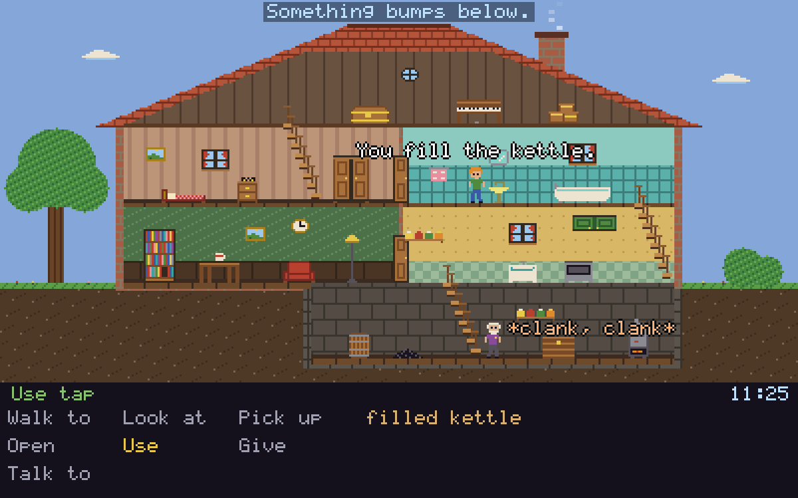

# The Last Teabag

A small point-and-click adventure in a cutaway house, built on [game-toolkit](https://github.com/sunsided/game-toolkit) and [loremaster](https://github.com/sunsided/loremaster) to find out whether the latter, a runtime for text adventures, copes with having a mouse attached.



The idea started with _Little Computer People_ (Activision, 1985) and its house with the front sawn off, tiny resident included: a perfectly good stage, I thought, for something that had so far only ever been text. None of the original's mechanics are here, and the house, the people, and the art are new; what stayed is the nod, and the question of what happens to an interactive fiction engine once you click on things SCUMM style and somebody has to walk over there first.

The plot is modest. There is one teabag left in the house, you intend to drink it, and Uncle Otto keeps his own schedule through the rooms (and has plans of his own at one o'clock).

## How it works

Everything that happens lives in `story/`, as a plain loremaster project: rooms, things, rules, Otto's agenda, his dialogue, and the endings. You can play it in loremaster's terminal player too, although you'll miss the walking.

The Rust host in `src/` sits on game-toolkit for the window, the drawing, and the mouse, and knows where things are on screen and nothing else. Crossing a room submits a `go` command, an action fires only once the player has arrived, and a tick every six seconds moves the clock, which is what gets Otto going while you stand around thinking.

It turns out this needed no changes to loremaster at all. The one thing I'd like from it is a way to tell text caused by your click from text caused by the world, as the host currently guesses by where the text came from (and rule ids starting with `ambient_` count as narration, which is exactly as elegant as it sounds).

## Controls

Pick a verb and click a thing, or click a thing right away (either button) for its suggested action. A right click always runs the suggestion. While somebody is talking, a click skips the line.

## Running it

You'll need [go-task](https://taskfile.dev), and checkouts of [loremaster](https://github.com/sunsided/loremaster) and [game-toolkit](https://github.com/sunsided/game-toolkit) next to this project, as `../loremaster` and `../../game-toolkit`:

```sh
task run    # play
task test   # host tests, story check, and walkthroughs
```

Native only for now, with no sound and no saving. Both path dependencies are moving targets, so YMMV.

## License

[EUPL-1.2](LICENSE).
